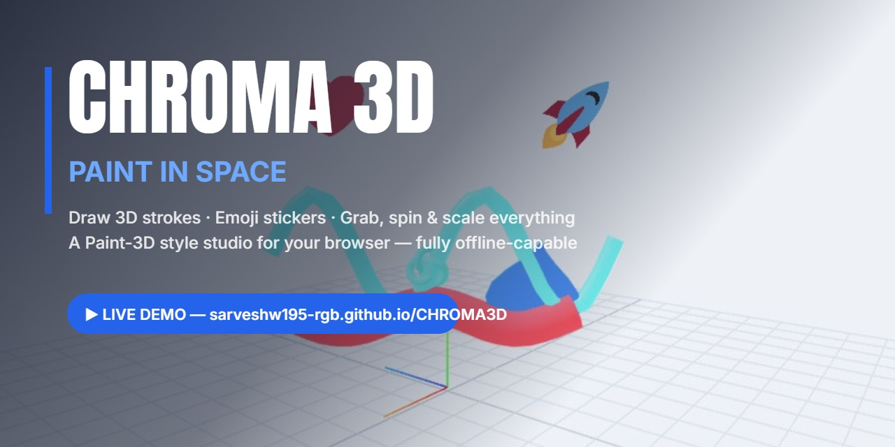
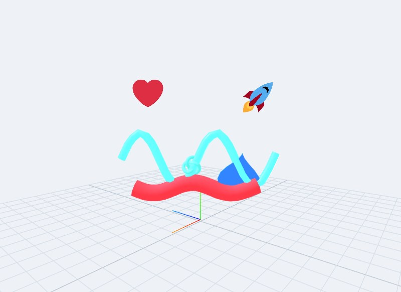

<div align="center">

# CHROMA 3D

**A Paint 3D-style 3D painting studio that runs in your browser — draw with neon, drop emoji stickers, spin and scale your art like scene objects.**

[](LICENSE)
[](https://sarveshw195-rgb.github.io/CHROMA3D/)
[]()
[](https://threejs.org/)



</div>

## ▶ PLAY IT LIVE — no install needed

<div align="center">

### [**OPEN CHROMA 3D → https://sarveshw195-rgb.github.io/CHROMA3D/**](https://sarveshw195-rgb.github.io/CHROMA3D/)

*One HTML file. Zero installs. Zero CDN calls. Works offline.*

</div>

## ✨ Features

| | | |
|:---:|:---|:---|
| 🎨 **Pens** | **Marker** — bold, clean tube strokes. **Pencil** — thin textured line. **Neon glow** — emissive stroke that lights up in the dark. **Chalk** — rough, grainy classroom feel. **Metal** — shiny reflective smear. | |
| 😀 **Stickers** | 16 emoji stickers (grin, sunglasses, heart, star, fire, rainbow, cat, dog, unicorn, pizza, rocket, football, music note, bulb, blossom, crown) rendered as billboard sprites with canvas textures repainted from bundled Twemoji SVGs. | |
| 🧊 **Objects** | 8 drop-in 3D models: cube, sphere, cone, cylinder, torus, torus knot, star, and a parametric heart. Colored with the current swatch. | |
| ✋ **Gizmos** | Paint-3D-style SELECT mode: grab to move on a camera-facing plane, blue ring for pitch/roll, orange flat ring for yaw, green handle for scale. | |
| ↩ **Undo** | One unified 60-step stack — strokes, stickers, objects *and* every transform you make are all undoable with Ctrl+Z. | |
| 💾 **Files** | Save your scene as a `.chroma` (JSON) file and reopen it later, plus transparent-PNG export of any composition. | |

**100% offline, 100% local:** Three.js is vendored, the Anton + Inter fonts are self-hosted woff2 files, and every emoji sticker is a bundled SVG. The app makes **no CDN calls at all** — once the page is loaded, you can pull the network cable and keep painting.

## 📸 Screenshots

<div align="center">



*A live scene captured from the app: neon wave, chalk stroke, rocket + heart stickers, heart and knot objects.*

</div>

## 🚀 Getting started

1. **The easy way** — open the live demo: [https://sarveshw195-rgb.github.io/CHROMA3D/](https://sarveshw195-rgb.github.io/CHROMA3D/)
2. **Run locally** — clone or download this repo, then from the repo folder:

```bash
npx serve .
```

3. **Build the single-file Windows exe** (~3.4 MB, fully self-contained, Neutralino-based, icon-patched):

```bash
npx -y @neutralinojs/neu@11 build --embed-resources
```

## ⌨️ Keyboard shortcuts

| Key | Action |
|:---:|:---|
| `B` | Draw (pen) |
| `G` | Emoji stickers |
| `O` | 3D objects |
| `S` | Select mode |
| `E` | Erase |
| `1` – `8` | Pick colour 1–8 |
| `Ctrl` + `Z` | Undo (60 steps) |
| `Delete` | Remove selected |
| `Esc` | Deselect / close panel |

## 📁 Project structure

```text
CHROMA3D/
├─ index.html          # the entire app — one self-contained file
├─ three.min.js        # Three.js r128, vendored locally (no CDN)
├─ fonts/              # self-hosted woff2 (Anton + Inter, OFL)
│  ├─ anton-400-normal.woff2
│  ├─ inter-400-normal.woff2
│  ├─ inter-500-normal.woff2
│  ├─ inter-600-normal.woff2
│  └─ inter-700-normal.woff2
├─ emoji/              # 16 bundled Twemoji SVG stickers
├─ assets/
│  ├─ banner.jpg       # README hero banner
│  └─ demo.jpg         # live scene screenshot
├─ LICENSE             # MIT
└─ README.md
```

## 🔧 How it works

- **Strokes** are CatmullRom curves swept into tube meshes, rebuilt live on a plane that always faces the camera as you orbit.
- **Emoji stickers** are billboard `THREE.Sprite`s with canvas textures repainted from the bundled Twemoji SVGs.
- **The select gizmo** is a camera-plane ring (pitch/roll) plus a flat yaw ring plus a scale handle — matching each handle's drag to the right rotation axis.
- **Undo** is one unified stack that snapshots transforms together with stroke and object creation, so Ctrl+Z rewinds everything in the order you did it.

## 🗺 Roadmap

- [ ] Paint directly onto object surfaces (mesh-projected strokes)
- [ ] Text tool — extrude words into the scene
- [ ] GLB / STL export of your composition
- [ ] Environment backgrounds (skyboxes, gradients, studio setups)
- [ ] Camera presets with smooth transitions

## 🤝 Contributing

PRs and issues are very welcome — see [CONTRIBUTING.md](CONTRIBUTING.md). The golden rule: keep the zero-CDN, single-file promise intact.

## 🙏 Credits

- **Three.js** — [threejs.org](https://threejs.org/) (MIT License)
- **Twemoji 15.1.0 SVGs** — [jdecked/twemoji](https://github.com/jdecked/twemoji), licensed **CC-BY 4.0** © Twitter, Inc. and contributors; emoji extracted and bundled unmodified
- **Anton & Inter fonts** — via [Fontsource](https://fontsource.org/), under the SIL Open Font License (OFL)

## 📄 License

Released under the [MIT License](LICENSE) © 2026 Evolv3D.

---

⭐ If CHROMA 3D sparks something you made, star the repo — it genuinely helps others find it.
